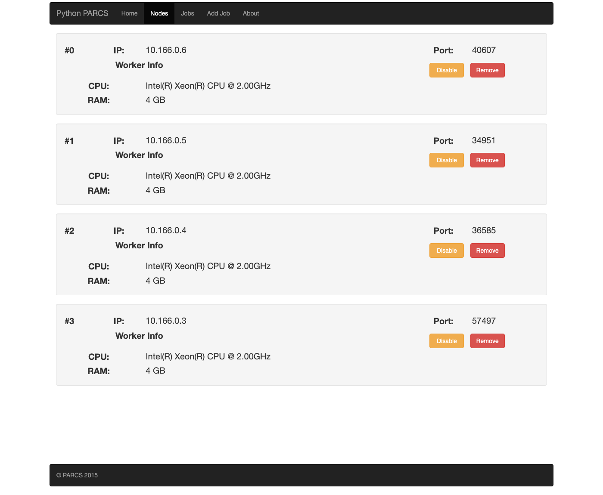
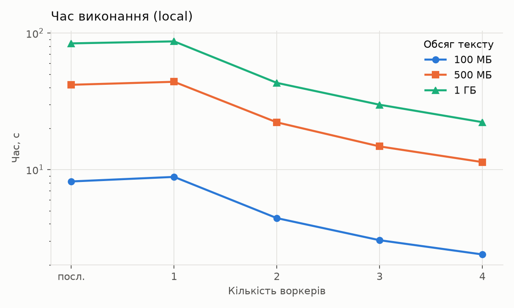
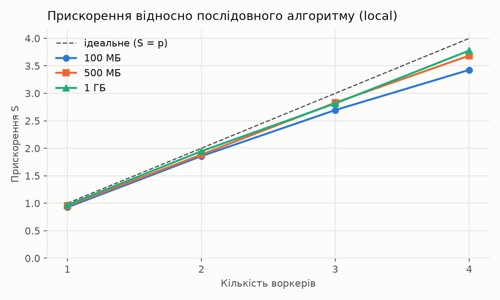
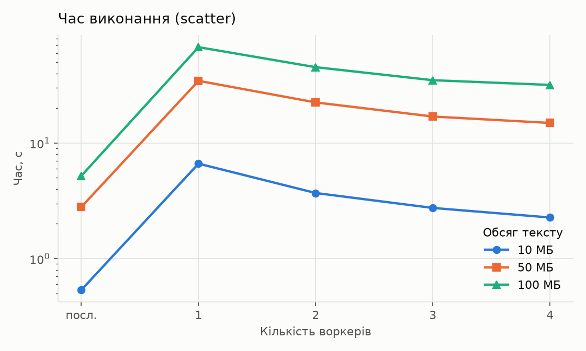
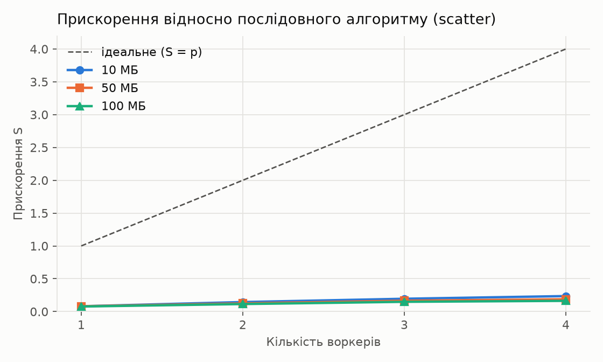

::: {custom-style="Title"}
Київський національний університет імені Тараса Шевченка
:::

::: {custom-style="Subtitle"}
Факультет комп'ютерних наук та кібернетики
:::

&nbsp;

&nbsp;

&nbsp;

::: {custom-style="Title"}
ЗВІТ ДО ЛАБОРАТОРНОЇ РОБОТИ 1
:::

::: {custom-style="Subtitle"}
з дисципліни «Хмарні обчислення»
:::

::: {custom-style="Subtitle"}
на тему: Паралельне шифрування Цезаря та XOR у системі ПАРКС (PARCS-Python) у хмарному середовищі Google Cloud Platform
:::

&nbsp;

&nbsp;

&nbsp;

&nbsp;

&nbsp;

::: {custom-style="Right"}
Студента 4 курсу
:::

::: {custom-style="Right"}
групи ТК-41
:::

::: {custom-style="Right"}
спеціальності 122 «Комп'ютерні науки»
:::

::: {custom-style="Right"}
Тимченка Олександра
:::

&nbsp;

&nbsp;

&nbsp;

&nbsp;

::: {custom-style="Title"}
Київ 2026
:::

```{=openxml}
<w:p><w:r><w:br w:type="page"/></w:r></w:p>
```

# Мета роботи

Обрати задачу паралельного програмування (шифрування та розшифрування тексту шифром Цезаря і XOR) та реалізувати її для платформи ПАРКС (PARCS-Python). Розгорнути систему ПАРКС у хмарному середовищі Google Cloud Platform, провести тестування послідовного та паралельного алгоритмів для різної кількості воркерів (master і 1–4 воркери), порівняти результати та оцінити прискорення й ефективність паралельної програми.

# Вступ

Шифр Цезаря і XOR-шифрування належать до найпростіших симетричних шифрів. Шифр Цезаря зсуває кожен байт тексту на фіксовану величину: $c_i = (p_i + k) \bmod 256$. XOR-шифрування накладає на текст ключ, що періодично повторюється: $c_i = p_i \oplus key[i \bmod |key|]$. Обидві операції побайтово незалежні, тому текст можна розбити на неперервні шматки й обробити їх паралельно на різних вузлах. Саме така «ідеально паралельна» структура задачі робить її зручною для порівняння двох речей: наскільки добре масштабуються власне обчислення і скільки коштує передача даних між вузлами.

Робота є портом власної MPI-реалізації на C++ (`serial.cpp`, `parallel.cpp`) на платформу PARCS-Python: збережено ті самі алгоритми, той самий ключ XOR із глобальним зсувом позиції і той самий розподіл даних між процесами ($count_i = rest / (p - i)$). У звіті досліджено два паралельні режими: режим `local`, у якому дані вже лежать на вузлах, і режим `scatter`, дослівний порт MPI-версії, де майстер розсилає текст воркерам і збирає результат.

Повний код проєкту, вхідні файли, результати вимірювань, графіки та інструкція з розгортання розміщені в репозиторії GitHub: <https://github.com/altiebalti/parcs-caesar-xor>.

# 1. Платформа ПАРКС та PARCS-Python

Технологія ПАРКС (Паралельні Асинхронні Рекурсивно Керовані Системи) запропонована А. В. Анісімовим як універсальний засіб побудови систем паралельної обробки інформації [1]. Її основу складають дві ідеї. Перша: замість нової мови програмування користувачеві пропонується базова алгоритмічна мова (Java, C, Python тощо), розширена невеликим набором засобів паралелізму, тому отримують ПАРКС-Java, ПАРКС-C і так далі. Друга: поняття керуючого простору, тобто множини точок, у які розподіляються алгоритмічні модулі, з визначеними законами взаємодії між ними. Базисний алгоритмічний модуль є послідовним дискретним перетворювачем із керуючою та інформаційною частинами й засобами взаємодії та синхронізації з іншими модулями за принципом рандеву Хоара; зі складених модулів шляхом композицій будуються складніші. ПАРКС-засоби дозволяють динамічно створювати і знищувати паралельні процеси та перекомутовувати зв'язки між ними, поєднуючи рекурсію й паралельність [1, розділ 2].

PARCS-Python [2] є реалізацією цієї технології для мови Python. Система складається з майстра (master) і воркерів (workers), кожен вузол працює в Docker-контейнері `hummer12007/parcs-node` (Python 2.7, Flask для веб-інтерфейсу та Pyro4 для віддалених викликів). Майстер надає веб-інтерфейс на порту 8080, через який додають задачі: файл розв'язку та вхідний файл. Розв'язок є Python-модулем із класом `Solver`, який має конструктор `__init__(workers, input_file_name, output_file_name)` і метод `solve()`. На майстрі `workers` є списком проксі Pyro4 на воркери, на воркерах клас завантажується без аргументів. Методи, позначені декоратором `@expose`, стають доступними для віддаленого виклику; виклик повертає об'єкт `FutureResult`, значення якого читають через `.value`, що дає асинхронність: майстер може запустити обчислення на всіх воркерах і лише потім чекати результатів. Аргументи та результати серіалізуються (serpent), тому двійкові дані передаються у вигляді base64-рядків.

# 2. Постановка задачі та ідея паралельного алгоритму

Вхідними даними є обсяг тексту $N$ байтів, зсув Цезаря $k = 3$, ключ XOR `SecretKey123!@#` (15 байтів) і зерно генератора. Текст генерується детерміновано блоками по 1 МБ, кожен блок зі свого зерна $(seed, idx)$, тому за будь-якої кількості воркерів дані однакові, а md5-відбитки шифротексту мають збігатися в усіх режимах. Для кожного запуску перевіряється, що розшифрований текст дорівнює вихідному (`PASSED`/`FAILED`).

Паралельний алгоритм ґрунтується на побайтовій незалежності обох шифрів: текст ділиться на $p$ неперервних шматків, кожен воркер шифрує й розшифровує свій шматок. Єдина нетривіальна деталь стосується XOR: ключ накладається не з початку шматка, а з глобальної позиції байта в тексті, $c_i = p_i \oplus key[(offset + i) \bmod |key|]$, інакше результат залежав би від кількості воркерів.

Реалізовано три режими, які задаються рядком `mode=` у вхідному файлі:

- **serial**: послідовний алгоритм; увесь конвеєр (генерація, шифрування й розшифрування Цезарем та XOR, перевірка) виконує майстер, воркери не використовуються. Майстер є такою самою VM, як і воркери, тому порівняння чесне.
- **local**: основний паралельний режим. Майстер ділить блоки між воркерами порівну, кожен воркер сам генерує свою частину тексту (модель «дані вже лежать на вузлах»), шифрує і розшифровує її, перевіряє результат і повертає майстру лише контрольні суми й таймінги. По мережі передаються лише параметри, тому очікуване прискорення близьке до лінійного.
- **scatter**: дослівний порт MPI-версії. Майстер генерує весь текст, розсилає шматки воркерам (аналог `MPI_Scatterv`), збирає зашифроване (`MPI_Gatherv`), розсилає знову для розшифрування і збирає ще раз, окремо для Цезаря і для XOR. Як і в C++ версії, генерація й перевірка не входять у виміряний час. Цей режим показує, скільки коштує передача даних порівняно з самими обчисленнями.

Прискорення для режиму `local` обчислюється як $S = T_{serial} / T_{local}$ за повним часом конвеєра; для `scatter` базою є сума часу Цезаря і XOR у послідовному режимі, так само, як у таблиці MPI-версії. Ефективність $E = S / p \cdot 100\%$.

# 3. Реалізація

Розв'язок оформлено одним файлом `solver.py` (Додаток А), сумісним із Python 2.7 (саме він у Docker-образі) і Python 3. Основні елементи:

- `gen_block(seed, idx, n)` генерує друкований текст довжини $n$ для блоку $idx$ детерміновано (Mersenne Twister), тому майстер і воркери отримують однакові дані незалежно від того, хто і скільки блоків генерує.
- Шифр Цезаря реалізовано через таблицю перекодування байтів і `bytes.translate()`, тобто цикл по байтах виконується в C. XOR виконується через довгу арифметику Python: текст і потік ключа переводяться у великі цілі числа й XOR-яться одним виразом. Це дозволяє працювати на Python 2.7 без NumPy, якого в образі немає, і значно швидше за цикл у Python.
- `process_blocks()` обробляє діапазон блоків на одному вузлі й повертає таймінги за етапами (генерація, Цезар, XOR, перевірка), результат перевірки та md5 кожного зашифрованого блоку. Цей самий код виконується в режимі `serial` на майстрі й у режимі `local` на воркерах через віддалений метод `Solver.process_range()`.
- Режим `scatter` використовує віддалені методи `caesar_chunk()` і `xor_chunk()`, які приймають шматок тексту у base64, обробляють його й повертають також у base64. Розподіл шматків повторює `parallel.cpp`: `split_counts()` обчислює $count_i = rest / (p - i)$ та зміщення.
- Для кожного обсягу програма виводить таблицю з часом, відбитками md5 і рядки `CSV,...`, які далі обробляє `report.py`.

Коректність перевірено двома способами: розшифрований текст порівнюється з вихідним на кожному запуску, а md5-відбитки шифротексту збігаються в усіх режимах і для будь-якої кількості воркерів (наприклад, для 100 МБ відбиток Цезаря `4e0e8be3e8bb67b6b0ddf7db719f618e` отримано і в `serial`, і в `local` на 1–4 воркерах, і в `scatter`). Локально, без хмари, програму можна запустити командою `python solver.py inputs/test_small.txt out.txt --workers 2`: воркери імітуються окремими процесами. Перед розгортанням розв'язок було також прогнано на справжньому PARCS-Python, піднятому локально (Python 2.7.18, Pyro4 4.75, майстер і 3 воркери).

Допоміжні скрипти: `cluster.sh` створює й видаляє кластер у Compute Engine, `run_all.sh` надсилає всі вхідні файли на майстер через його HTTP API і збирає output-файли, `report.py` будує таблиці прискорення й ефективності та графіки.

# 4. Розгортання системи ПАРКС у Google Cloud Platform

Систему розгорнуто у проєкті Google Cloud `project-abae6256-cc9d-4a12-b5b` (Free Trial), регіон Європа (Фінляндія), зона `europe-north1-b`. Створено п'ять віртуальних машин: один master і чотири воркери. Параметри середовища наведено в таблиці 1, вкладка Nodes із чотирма зареєстрованими воркерами показана на рисунку 1.

Таблиця 1 — Параметри тестового середовища

| Параметр | Значення |
|---|---|
| Платформа | Google Compute Engine, зона europe-north1-b |
| Кількість вузлів | 5 (1 master + 4 воркери) |
| Тип ВМ | n1-standard-1: 1 vCPU, 3,75 ГБ RAM (веб-інтерфейс ПАРКС показує 4 GB) |
| Процесор | Intel Xeon @ 2.00 GHz |
| ОС вузлів | Container-Optimized OS (cos-stable), Docker вбудований |
| Образ ПАРКС | hummer12007/parcs-node (Docker Hub); Python 2.7 у контейнері, Pyro4 |
| Мережа | внутрішня мережа VPC 10.166.0.0/20; веб-інтерфейс master на порту 8080 відкрито лише для IP Cloud Shell і власного IP |
| Керування кількістю воркерів | параметр `workers=` у вхідному файлі (кластер піднімається один раз) |

{width=90%}

Розгортання виконується скриптом `cluster.sh` у Cloud Shell (повна інструкція в Додатку Б):

1. вмикається Compute Engine API; створюється правило фаєрвола `parcs-web`, яке відкриває порт 8080 лише для IP-адреси Cloud Shell і адреси користувача (правило `allow-all` з офіційного гайду свідомо не використовується, бо через веб-інтерфейс ПАРКС можна виконати довільний код на VM);
2. створюється VM `master` зі startup-скриптом, який запускає контейнер `docker run --network=host -e PARCS_ARGS="master" hummer12007/parcs-node`;
3. створюються VM `worker1`–`worker4` з аналогічним скриптом і `PARCS_ARGS="worker <внутрішня IP master>"`;
4. скрипт чекає, поки всі воркери зареєструються на майстрі (`/api/worker`), і друкує адресу веб-інтерфейсу.

Під час розгортання виникли особливості, які відрізняються від базової інструкції PARCS-Python:

- команда `create-with-container` (підкоманда `gcloud compute instances`) з офіційного гайду позначена в gcloud як deprecated, тому використано звичайні VM зі startup-скриптом, що запускає контейнер з параметром `--network=host`;
- у зоні `europe-north1-a` не було вільних машин типу `n1-standard-1` (помилка `ZONE_RESOURCE_POOL_EXHAUSTED`), тому всі вузли створено в сусідній зоні `europe-north1-b`;
- Container-Optimized OS має власний host-firewall, який пропускає лише SSH: воркери не могли під'єднатися до майстра (`Connection timed out` на `10.166.0.2:8080`). У startup-скрипт додано правила `iptables`, що дозволяють TCP із внутрішньої мережі (Pyro4 і Flask на воркерах слухають випадкові порти) та порт 8080; для вже створених VM є команда `cluster.sh fix-firewall`;
- в образі працює Python 2.7, тому у файлі розв'язку оголошено кодування `utf-8` і уникнуто конструкцій Python 3 (f-рядки, анотації типів).

# 5. Експерименти

Усі 10 задач надіслано на майстер скриптом `run_all.sh` і виконано по черзі (рисунок 2). Для режиму `local` використано обсяги 100 МБ, 500 МБ і 1 ГБ, для `scatter` 10, 50 і 100 МБ, бо майстер тримає в пам'яті весь текст і кілька його копій. Кожен замір виконано один раз; усі запуски дали `PASSED`, відбитки збіглися.

{width=55%}

## 5.1. Режим local

Таблиця 2 — Час виконання, прискорення та ефективність у режимі local

| Розмір | Воркери | Час, с | Прискорення S | Ефективність E, % |
|---|---|---|---|---|
| 100 МБ | послідовний | 8,180 | 1,00 | 100 |
| 100 МБ | 1 | 8,832 | 0,93 | 93 |
| 100 МБ | 2 | 4,405 | 1,86 | 93 |
| 100 МБ | 3 | 3,035 | 2,70 | 90 |
| 100 МБ | 4 | 2,387 | 3,43 | 86 |
| 500 МБ | послідовний | 41,783 | 1,00 | 100 |
| 500 МБ | 1 | 43,934 | 0,95 | 95 |
| 500 МБ | 2 | 22,164 | 1,89 | 94 |
| 500 МБ | 3 | 14,768 | 2,83 | 94 |
| 500 МБ | 4 | 11,335 | 3,69 | 92 |
| 1 ГБ | послідовний | 83,989 | 1,00 | 100 |
| 1 ГБ | 1 | 86,882 | 0,97 | 97 |
| 1 ГБ | 2 | 43,136 | 1,95 | 97 |
| 1 ГБ | 3 | 29,832 | 2,82 | 94 |
| 1 ГБ | 4 | 22,234 | 3,78 | 94 |

{width=85%}

{width=85%}

Розподіл часу на одному вузлі для 1 ГБ у послідовному режимі: генерація тексту 25,5 с, XOR 51,9 с, шифр Цезаря 1,6 с, решта перевірка. Отже, на один байт припадає близько 25 нс генерації, 52 нс XOR і лише 1,5 нс Цезаря (`bytes.translate` виконується в C).

## 5.2. Режим scatter

Таблиця 3 — Час виконання, прискорення та ефективність у режимі scatter (база: Цезар + XOR у послідовному режимі)

| Розмір | Воркери | Час, с | Прискорення S | Ефективність E, % |
|---|---|---|---|---|
| 10 МБ | послідовний | 0,536 | 1,00 | 100 |
| 10 МБ | 1 | 6,629 | 0,08 | 8 |
| 10 МБ | 2 | 3,694 | 0,14 | 7 |
| 10 МБ | 3 | 2,744 | 0,20 | 7 |
| 10 МБ | 4 | 2,268 | 0,24 | 6 |
| 50 МБ | послідовний | 2,796 | 1,00 | 100 |
| 50 МБ | 1 | 34,503 | 0,08 | 8 |
| 50 МБ | 2 | 22,441 | 0,12 | 6 |
| 50 МБ | 3 | 16,945 | 0,17 | 6 |
| 50 МБ | 4 | 14,916 | 0,19 | 5 |
| 100 МБ | послідовний | 5,204 | 1,00 | 100 |
| 100 МБ | 1 | 67,481 | 0,08 | 8 |
| 100 МБ | 2 | 45,277 | 0,11 | 6 |
| 100 МБ | 3 | 34,930 | 0,15 | 5 |
| 100 МБ | 4 | 31,802 | 0,16 | 4 |

{width=85%}

{width=85%}

# 6. Аналіз результатів

**Режим local.** Прискорення близьке до лінійного: для 1 ГБ на чотирьох воркерах $S = 3{,}78$ при ефективності 94 %. Накладні витрати на виклики Pyro4 становлять близько 10 мс на запуск (стовпець Overhead у вихідних файлах), тобто менше 0,1 % часу. Втрати відносно ідеального прискорення мають дві причини. По-перше, час усього запуску визначає найповільніший воркер: окремі VM відрізняються на кілька відсотків (запуск на одному воркері повільніший за послідовний на майстрі на 3–7 %). По-друге, для 100 МБ частка фіксованих витрат більша, тому ефективність нижча (86 %), а зі збільшенням обсягу вона зростає до 94 %: це класична поведінка за законом Густафсона, коли паралельна частина росте разом із задачею.

**Режим scatter.** Паралельна версія повільніша за послідовну в усіх конфігураціях: $S = 0{,}08$ на одному воркері та лише $0{,}16$ на чотирьох. Причина в обчислювальній інтенсивності задачі. На кожен байт припадає 1,5 нс обчислень для Цезаря і 52 нс для XOR, тоді як у режимі `scatter` кожен байт чотири рази проходить через мережу туди й назад (шифрування і розшифрування для кожного з двох шифрів), до того ж у base64 (+33 % обсягу) і через серіалізацію Pyro4. Для 100 МБ через майстер проходить близько 800 МБ даних, і на одному воркері це займає 62 с понад час обчислень, тобто приблизно 78 нс на байт на кожну передачу. Передача дорожча за обчислення на один-два порядки, тому задача є комунікаційно обмеженою. Збільшення кількості воркерів допомагає лише частково (67 с → 32 с), бо паралелізуються тільки приймання, кодування і обчислення на воркерах, а майстер залишається вузьким місцем: він один серіалізує, передає й приймає всі дані через одну мережеву карту й один vCPU. Це закон Амдала з великою послідовною частиною.

**Порівняння режимів.** Обидва режими дають однакові md5-відбитки шифротексту, тобто реалізують один і той самий алгоритм; відрізняється лише те, де лежать дані. Коли дані вже є на вузлах (`local`), шифрування масштабується майже ідеально. Коли дані треба роздати з одного вузла (`scatter`), для таких дешевих операцій, як Цезар і XOR, вигідніше взагалі не паралелити. Це й підтверджує висновок MPI-версії: розподілені обчислення виграють тоді, коли обчислень на байт даних багато або коли дані розподілені заздалегідь.

# Висновки

1. Реалізовано паралельне шифрування та розшифрування шифром Цезаря і XOR для платформи PARCS-Python у трьох режимах: послідовному, `local` (дані генеруються на воркерах) і `scatter` (порт MPI-версії з розсиланням даних з майстра). Коректність підтверджено перевіркою розшифрованого тексту й збігом md5-відбитків шифротексту в усіх режимах.
2. Систему ПАРКС розгорнуто в Google Cloud Platform: master і 4 воркери на VM `n1-standard-1` у зоні `europe-north1-b`, Docker-образ `hummer12007/parcs-node`, автоматизовано скриптом `cluster.sh`. Виявлено і подолано три особливості: застарілу команду `create-with-container`, брак ресурсів у зоні `europe-north1-a` та host-firewall Container-Optimized OS, що блокував з'єднання воркерів з майстром.
3. У режимі `local` отримано прискорення 1,95, 2,82 і 3,78 для 2, 3 і 4 воркерів на 1 ГБ тексту при ефективності 94–97 %, що близько до лінійного.
4. У режимі `scatter` паралельна версія повільніша за послідовну (прискорення 0,08–0,24), бо передача байта між вузлами коштує на порядок більше за його шифрування. Задача є комунікаційно обмеженою, а майстер залишається вузьким місцем незалежно від кількості воркерів.
5. Загальний висновок: ефективність паралельної програми визначає не кількість вузлів, а відношення обчислень до обміну даними. Для задач з низькою обчислювальною інтенсивністю дані мають бути розподілені заздалегідь, інакше паралелізм не дає виграшу.

# Література

1. Дерев'янченко О. В. Система ПАРКС-JAVA для паралельних обчислень на комп'ютерних мережах: навчальний посібник. Київ: КНУ імені Тараса Шевченка.
2. PARCS-Python: <https://github.com/Hummer12007/parcs-python>.
3. Документація Google Compute Engine: <https://cloud.google.com/compute/docs>.
4. Container-Optimized OS, host firewall: <https://cloud.google.com/container-optimized-os/docs/how-to/create-configure-instance>.
5. Репозиторій роботи: <https://github.com/altiebalti/parcs-caesar-xor>.

```{=openxml}
<w:p><w:r><w:br w:type="page"/></w:r></w:p>
```

# Додаток А. Файл розв'язку solver.py

SOLVER_LISTING

```{=openxml}
<w:p><w:r><w:br w:type="page"/></w:r></w:p>
```

# Додаток Б. Інструкція з розгортання та запуску

Репозиторій проєкту: <https://github.com/altiebalti/parcs-caesar-xor>. Структура: `solver.py` — розв'язок для ПАРКС; `inputs/` — вхідні файли для всіх запусків; `cluster.sh` — створення й видалення кластера в Compute Engine; `run_all.sh` — надсилання задач на майстер і збирання результатів; `report.py` — таблиці та графіки; `outputs/` — вихідні файли запусків, `results.csv`, `summary.md` і графіки; `report/` — цей звіт і рисунки.

## Б.1. Підготовка Google Cloud

Потрібен проєкт з активним Free Trial. Усі команди виконуються в Cloud Shell (кнопка Activate Cloud Shell у консолі), де `gcloud` уже встановлений і залогінений.

```bash
git clone https://github.com/altiebalti/parcs-caesar-xor.git
cd parcs-caesar-xor
gcloud config set project <PROJECT_ID>
```

## Б.2. Створення кластера

```bash
export ZONE=europe-north1-b        # за замовчуванням europe-north1-a
MY_IP=<ваш IP з https://ifconfig.me> bash cluster.sh up 4
```

Скрипт вмикає Compute Engine API, створює правило фаєрвола `parcs-web` (порт 8080 лише для Cloud Shell і `MY_IP`), VM `master` і `worker1`–`worker4` типу `n1-standard-1` на Container-Optimized OS зі startup-скриптом, який відкриває порти в host-firewall і запускає контейнер `hummer12007/parcs-node` у мережі хоста. Далі він чекає реєстрації воркерів і друкує адресу `http://<IP майстра>:8080`. Якщо зона не має вільних машин (`ZONE_RESOURCE_POOL_EXHAUSTED`), змініть `ZONE` і повторіть команду. Інші команди: `status`, `ip`, `allow` (оновити IP у фаєрволі), `fix-firewall` (відкрити порти на вже створених VM), `stop`/`start`, `down`.

Startup-скрипт вузла:

```bash
#!/bin/bash
iptables -w -I INPUT -p tcp -s 10.0.0.0/8 -j ACCEPT
iptables -w -I INPUT -p tcp --dport 8080 -j ACCEPT
docker start parcs 2>/dev/null || \
  docker run -d --name parcs --restart=always --network=host \
    -e PARCS_ARGS="worker <внутрішня IP master>" hummer12007/parcs-node
```

## Б.3. Запуск експериментів

```bash
bash run_all.sh $(bash cluster.sh ip)       # усі 10 задач по черзі, результати в outputs/
pip3 install --user matplotlib
python3 report.py outputs/                  # summary.md, results.csv, графіки
```

`run_all.sh` надсилає кожен вхідний файл разом із `solver.py` на `POST /api/job` майстра і чекає, поки `GET /api/job/<id>/output` поверне результат. Те саме можна зробити вручну через веб-інтерфейс: Add Job, файл розв'язку `solver.py`, вхідний файл з `inputs/`.

Формат вхідного файлу:

```
mode=local                              # serial | local | scatter
workers=4                               # скільки воркерів узяти (0 = усі)
sizes=100000000, 500000000, 1000000000  # обсяги тексту в байтах
shift=3                                 # зсув Цезаря
key=SecretKey123!@#                     # ключ XOR
seed=2026                               # зерно генератора
```

## Б.4. Видалення ресурсів

```bash
bash cluster.sh down     # видаляє VM і правило фаєрвола
```

```{=openxml}
<w:p><w:r><w:br w:type="page"/></w:r></w:p>
```

# Додаток В. Приклад вихідного файлу (local_w4.txt)

```
LOCAL_W4_LISTING
```
